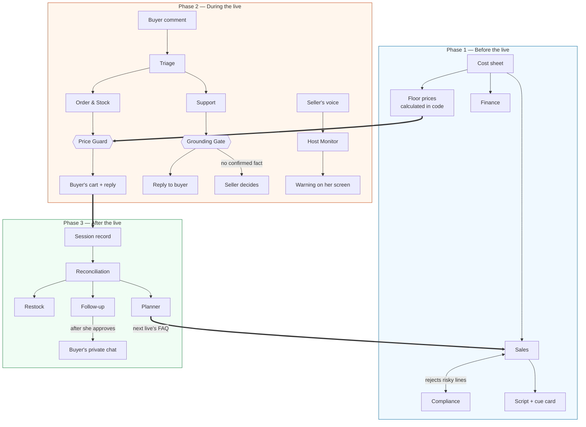

# 🎙️ StreamSense: Live Commerce Co-Pilot

[](#)
[](#)
[](#)

**StreamSense** is the operations team a solo live-seller cannot afford. A Malaysian home seller going live alone is host, customer service, cashier, stock-keeper and marketer at once — so she loses buyers in the comment flood, gives away margin without knowing it, and forgets her buyers the moment the live ends. StreamSense gives her a crew of AI agents that prepare her live, work backstage while she is on camera, and settle everything afterwards, with a **Price Guard** that never lets a loss-making price through.

*Built at Dormathon 2026 — Track 2: WorkBuddy, Agentic Solutions.*

---

## 📖 Table of Contents
- [🚀 Key Features](#-key-features)
- [🤖 The Agents](#-the-agents)
- [🛠️ Technical Architecture](#️-technical-architecture)
- [🏗️ How It Works](#️-how-it-works)
- [🇲🇾 Relevance & Impact](#-relevance--impact)
- [💻 Getting Started](#-getting-started)
- [📂 Project Structure](#-project-structure)
- [⚠️ What Is Simulated](#️-what-is-simulated)

---

## 🚀 Key Features

### 1. Pre-Live Planning (Prepare)
The seller uploads her cost sheet and one button puts a team to work.
- **Floor prices from her own costs:** cost, packaging, shipping share, platform fee and minimum margin become a floor price per product. This is calculated in code, not by a model.
- **Script and cue card:** a run-of-show in Bahasa Malaysia with English and Mandarin lines, and a one-page printable cue card.
- **Compliance review:** health claims, guarantees and unbacked halal claims are rejected and sent back to be rewritten before she goes on air.

### 2. Live Studio (seller)
One screen while she is on camera.
- **Camera and live video** to every buyer.
- **Live comments with an agent trail:** each comment shows which agents handled it and the reply it got.
- **"Needs you":** only the few things that need a human — questions with no confirmed answer, offers above her floor, bulk orders, warnings.
- **Stock that counts itself:** a buyer writes "nak 3 jar!" and the stock drops 120 → 117 as the items land in their cart.
- **Price Guard:** a flash deal below her floor is blocked with the lowest safe price, e.g. *"Blocked. Your floor is RM11.50. Safe deal: RM12.00."*
- **Vouchers that cannot lose money:** she offers "RM5 off when you spend RM30"; the Price Guard only lets it go live if no qualifying cart could fall below its floors, and checks each cart again at checkout.
- **Host Monitor:** it listens to what she says and warns her across her own video when she quotes a wrong price or stock figure, makes a risky promise, or states a health claim. Facts she states are remembered and used to answer buyers.

### 3. Buyer Room
What her customers see on their phones.
- Live video, comments in Bahasa Malaysia, English, Mandarin or a mix.
- **Cart and checkout:** reserved items appear in the buyer's cart; checkout is simulated.
- **Vouchers:** tap to claim; the saving comes off at checkout.
- **Private chat** with the shop, where follow-ups arrive after the live.

### 4. Post-Live Wrap-up
One button settles the night.
- **Sales sheet:** paid orders, platform fees, cost and profit — calculated in code from her cost sheet.
- **Who left items unpaid**, with a drafted follow-up message for each, sent to the buyer's private chat only after she approves.
- **Supplier message** for anything low or sold out.
- **Next live's FAQ**, built from tonight's unanswered questions and fed back into the next preparation.
- **She only answers once:** anything she confirms during a live is remembered and answered automatically in her next lives.

---

## 🤖 The Agents

Eleven agents in three teams, plus two rule gates that are deliberately *not* AI.

| Team | Agents | What they do |
| :--- | :--- | :--- |
| **Before the live** | Finance · Sales · Compliance | Explain the floors, write the script and cue card, reject risky lines until the script passes |
| **During the live** | Triage · Order & Stock · Support · Coach · Host Monitor | Route every comment, reserve and cancel, answer from confirmed facts, nudge the seller, check what she says |
| **After the live** | Reconciliation · Restock · Follow-up · Planner | Sales sheet, supplier message, buyer follow-ups, next FAQ |
| **Rule gates (code)** | Price Guard · Grounding Gate | Nothing below the floor price; no answer without a live number or a confirmed fact |

**Design principle:** models decide *meaning and action*; code decides *money, stock and facts*. Every sentence a buyer reads is a template filled with real numbers or a fact the seller confirmed — an agent can choose to reserve stock, but it cannot invent a price.

Open `/agents` while the app is running to watch each comment travel through the team.

---

## 🛠️ Technical Architecture

| Component | Technology | Purpose |
| :--- | :--- | :--- |
| **App** | Next.js (App Router), React, TypeScript | Seller pages, buyer room, API routes |
| **Real-time sync** | Server-Sent Events over an in-memory room | Every open page updates the moment anything changes |
| **Live agents** | Our own tool-calling agent loop, on open models served by Groq (`gpt-oss-120b`, `gpt-oss-20b`, `qwen3.8-27b`) | Triage, Order & Stock, Support, Coach, Host Monitor |
| **Pre/post-live teams** | WorkBuddy agent teams, connected through MCP | Finance, Sales, Compliance; Reconciliation, Restock, Follow-up, Planner |
| **Agent connection** | Model Context Protocol endpoint (`/api/mcp`) | Lets an agent platform read the live and hand in its work |
| **Rule gates** | Plain TypeScript | Price Guard, Grounding Gate, floor prices, sales figures |
| **Video** | LiveKit | Seller's camera to every buyer |
| **Speech** | Browser speech recognition, optional Whisper model on Groq | Turns what the seller says into text for the Host Monitor |
| **Tests** | Vitest | Triage rules, guards, agent tool loop, cart, floors |

The model keys and secrets stay on the server and never reach the browser.

---

## 🏗️ How It Works



---

## 🇲🇾 Relevance & Impact

- **Protects margin:** home sellers often discount on impulse without knowing their cost after platform fees and postage. A floor price enforced in real time stops sales at a loss.
- **Captures intent that is otherwise lost:** buyers who asked, reserved or bargained and then disappeared are followed up instead of forgotten.
- **Built for how Malaysians actually comment:** Bahasa Malaysia, English, Mandarin and Manglish in the same chat.
- **Responsible by design:** health claims are never confirmed, product facts are never invented, and nothing is sent to a buyer after the live without the seller's approval.

---

## 💻 Getting Started

```bash
npm install
cp .env.example .env.local     # add keys — the file explains where to get them
npm run check:keys             # optional: tests the keys without printing them
npm run dev
```

| Open | For |
| :--- | :--- |
| `http://localhost:3000/prepare` | Upload a cost sheet and prepare the live |
| `http://localhost:3000/` | Seller's live studio |
| `http://localhost:3000/buyer` | Buyer room (open on a phone, or a second window) |
| `http://localhost:3000/wrapup` | After the live |
| `http://localhost:3000/agents` | Watch the agents work |

It starts without any keys: comments are then handled by keyword rules and there is no video.

- **Try it quickly:** upload `data/cost_sheet.csv` on the Prepare page, press *Load products and floor prices only*, go live, and comment from the buyer room.
- **Test every function:** [`test-kit/TEST_PLAN.md`](test-kit/TEST_PLAN.md) is a step-by-step checklist using a second shop.
- **Architecture, deployment and what is verified:** [`BUILD.md`](BUILD.md).

---

## 📂 Project Structure

```text
src/
├── app/
│   ├── page.tsx              # Seller live studio
│   ├── prepare/              # Before the live
│   ├── wrapup/               # After the live
│   ├── buyer/                # Buyer room
│   ├── agents/               # Agents view
│   └── api/                  # stream (SSE), comments, buyer, action, mcp, session, live-token, transcribe
├── components/               # Studio, navigation, video, team progress
└── lib/
    ├── agents/               # Agent loop, live team, Host Monitor
    ├── backstage.ts          # The only code that changes the room: reserve, guard, reply
    ├── priceGuard.ts         # The money rule
    ├── floors.ts             # Floor prices from the cost sheet
    ├── triage.ts             # Keyword rules (fallback)
    ├── pipeline.ts           # Comment queue and seller actions
    ├── session.ts            # Session record and sales figures
    └── workspace.ts          # Uploads, pre-live pack, wrap-up
data/                         # Sample cost sheet and comments
test-kit/                     # A second shop and a full test checklist
```

---

## ⚠️ What Is Simulated

- **The marketplace.** This is our own live room standing in for a marketplace live. It is not connected to Shopee or TikTok; a real connector is future work.
- **Payment.** Checkout marks an order as paid; no money moves.
- **Buyer identity.** A buyer is the name they type.

Everything else — the agents' decisions, the guards, the video, the stock and the sales figures — runs for real.

**Roadmap:** marketplace connectors, WhatsApp and WeChat follow-up for sellers' own customer lists, and an AI host that can run the live while the seller approves decisions.
